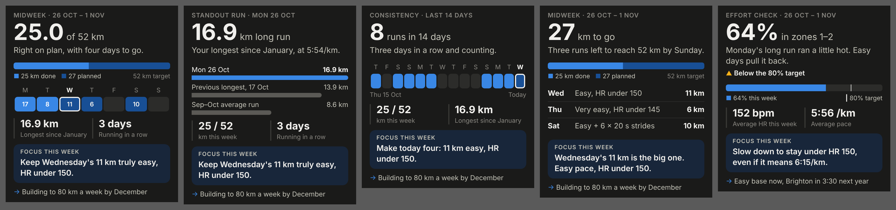

# Email templates

Five HTML templates for the midweek motivation email. They share one layout, so
every email looks the same, and each one fits on one phone screen in the Gmail
app (about 280 × 370 CSS px) with no scrolling.



## Which template

Pick the first one that matches this week's data:

| # | Template | Use when | Hero stat |
|---|---|---|---|
| 1 | `04-catch-up` | km done is more than 10% behind the plan for the days so far | km to go |
| 2 | `02-standout-run` | a new longest run in 8+ weeks, a PR or a fastest split this week | the run |
| 3 | `05-easy-effort` | zones 1–2 under 80% this week, or easy runs above HR 150 at ~6:00/km | % in zones 1–2 |
| 4 | `03-streak` | 3+ running days in a row, or weeks in a row on target | streak / runs |
| 5 | `01-week-progress` | anything else (the default) | km of target |

If an issue (zones, HR drift, behind target) doesn't get the template, it still
goes in the focus line.

## How to send

1. Write a JSON file with the template name, the text and the numbers. Copy the
   matching file in `examples/` and change the values.
2. Render it:
   ```
   python3 email_templates/render_email.py --strict path/to/this-week.json
   ```
   This writes `email_templates/out/<name>.html` and `.txt`, and fails if any
   text is too long for one screen or the message breaks the 3–5 line, under
   60 word rule.
3. Send with Gmail: `subject` from the JSON, `htmlBody` = the `.html` file,
   `body` = the `.txt` file.

## Slots

Text is escaped, so plain text only. Limits keep each email on one screen.

| Slot | Limit | Notes |
|---|---|---|
| `subject` | 32 chars | Fits on one line in the Gmail app |
| `kicker` | 32 chars | e.g. `Midweek · 26 Oct – 1 Nov` (shown in capitals) |
| `hero_value` | 6 chars | The one standout number: `25.0`, `16.9`, `64%` |
| `hero_unit` | 16 chars | e.g. `of 52 km`, `km long run` |
| `caption` | 80 chars | One sentence on why the number matters |
| `stat1_value`, `stat2_value` | 9 chars | Supporting stats (templates 01, 02, 03, 05) |
| `stat1_label`, `stat2_label` | 22 chars | |
| `focus` | 72 chars | The one focus for the rest of the week |
| `goal` | 52 chars | One line linking to the goals |
| `message` | 3–5 lines, < 60 words | Plain-text version; its first line is the inbox preview |
| `preheader` | optional | Inbox preview text, if not the first message line |

Chart data (shapes are in the examples):

| Key | Templates | Data |
|---|---|---|
| `progress` | 01, 04 | `done`, `planned` (km still planned), `target` km |
| `days` | 01 (7 days, with `km`), 03 (14 days) | `label`, `state` (`done`, `planned`, `rest`, `missed`), optional `km`, `today` |
| `strip_start`, `strip_end` | 03 | Labels under the 14-day strip |
| `compare` | 02 | 2–3 rows: `label`, `value`, `display`, `highlight` on the standout one |
| `sessions` | 04 | Up to 3 rows: `day`, `session`, `km` |
| `meter` | 05 | `value` %, `target` %, `label` |
| `status` | 05 | `state` (`warning` or `good`) and `label` |

## Design notes

- Dark by design. Gmail's dark mode recolours light emails but leaves dark
  ones alone, and a dark card still reads well in light mode.
- Bars are table cells with a `bgcolor` and a non-breaking space. Gmail strips
  empty `<div>`s, which is why the earlier bars disappeared.
- Colours come from the dataviz reference palette (dark mode): blue `#3987e5`
  for done, `#184f95` for planned, grey for the rest. Status colours always come
  with an icon and a label.
- All styles are inline; there's no `<style>` block for Gmail to drop.
