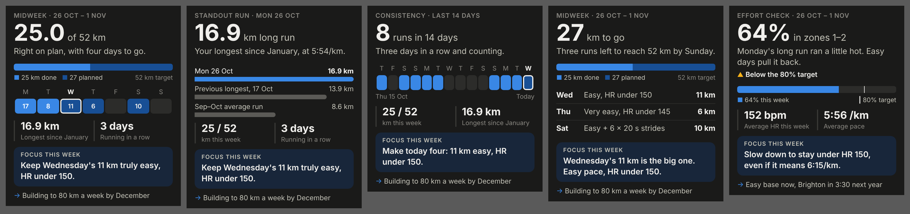
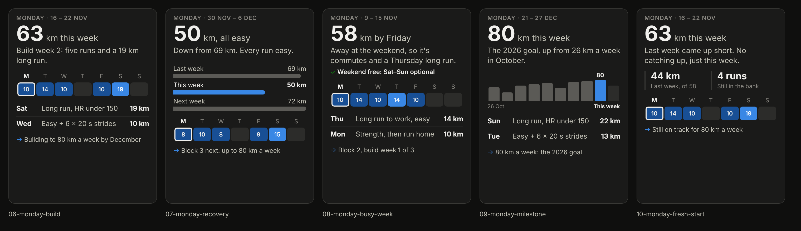

# Email templates

HTML templates for two coach emails: five for the **midweek** motivation email
(01–05) and five for the **Monday morning** message (06–10), which sums up the
week's plan. They share one layout, so every email
looks the same, and each one fits on one phone screen in the Gmail app (about
280 × 370 CSS px) with no scrolling.



## Which midweek template

Pick the first one that matches this week's data:

| # | Template | Use when | Hero stat |
|---|---|---|---|
| 1 | `04-catch-up` | km done is more than 10% behind the plan for the days so far | km to go |
| 2 | `02-standout-run` | a new longest run in 8+ weeks, a PR or a fastest split this week | the run |
| 3 | `05-easy-effort` | zones 1–2 under 80% this week, or easy runs above HR 150 at ~6:00/km | % in zones 1–2 |
| 4 | `03-streak` | 3+ running days in a row, or weeks in a row on target | streak / runs |
| 5 | `01-week-progress` | anything else (the default) | km of target |

If an issue (zones, HR drift, behind target) doesn't get the template, it still
goes in the focus line.

## Which Monday template



Send on Monday morning, after the week's sessions are planned in the training
plan. Pick the first one that matches:

| # | Template | Use when | Hero stat | Shows |
|---|---|---|---|---|
| 1 | `10-monday-fresh-start` | last week finished more than 10% under target, or the long run was missed | this week's km | last week in two stats |
| 2 | `07-monday-recovery` | a recovery week (planned or taken early) | this week's km | last and next week's km |
| 3 | `08-monday-busy-week` | work, travel or being away moves or squeezes the week | km and by when | status line |
| 4 | `09-monday-milestone` | 80 km, a new longest run, or the last build week of a block | this week's km | weekly km across the plan |
| 5 | `06-monday-build` | anything else (the default) | this week's km | nothing extra |

Every Monday email has a table of the week's runs, day by day (Mon–Sun, with
rest days and a total), and ends with a goal line. Never ask to make up missed km.

## How to send

1. Write a JSON file with the template name, the text and the numbers. Copy the
   matching file in `examples/` and change the values.
2. Render it:
   ```
   python3 email_templates/render_email.py --strict path/to/this-week.json
   ```
   This writes `email_templates/out/<name>.html` and `.txt`, and fails if any
   text is too long for one screen or the message breaks the 3–5 line, under
   60 word rule.
3. Send with Gmail: `subject` from the JSON, `htmlBody` = the `.html` file,
   `body` = the `.txt` file.

## Slots

Text is escaped, so plain text only. Limits keep each email on one screen.

| Slot | Limit | Notes |
|---|---|---|
| `subject` | 32 chars | Fits on one line in the Gmail app |
| `kicker` | 32 chars | e.g. `Midweek · 26 Oct – 1 Nov` (shown in capitals) |
| `hero_value` | 6 chars | The one standout number: `25.0`, `16.9`, `64%` |
| `hero_unit` | 16 chars | e.g. `of 52 km`, `km long run` |
| `caption` | 80 chars (64 on Monday) | One sentence on why the number matters; on Monday, the week's plan in a line |
| `stat1_value`, `stat2_value` | 9 chars | Supporting stats (templates 01, 02, 03, 05, 07, 10) |
| `stat1_label`, `stat2_label` | 22 chars | |
| `focus` | 72 chars | The one focus for the rest of the week (midweek) |
| `goal` | 52 chars | One line linking to the goals |
| `message` | 3–5 lines, < 60 words | Plain-text version; its first line is the inbox preview |
| `preheader` | optional | Inbox preview text, if not the first message line |

Chart data (shapes are in the examples):

| Key | Templates | Data |
|---|---|---|
| `progress` | 01, 04 | `done`, `planned` (km still planned), `target` km |
| `days` | 01 (7 days, with `km`), 03 (14 days) | `label`, `state` (`done`, `planned`, `rest`, `missed`), optional `km`, `today` |
| `plan` | 06–10 | 7 rows, Mon–Sun: `day`, `session` (30 chars), `km` (leave out on rest days), `key: true` on the long run. The total is added for you |
| `strip_start`, `strip_end` | 03 | Labels under the 14-day strip |
| `compare` | 02 | 2–3 rows: `label`, `value`, `display`, `highlight` on the standout one |
| `sessions` | 04 | Up to 3 rows: `day`, `session` (24 chars), `km` |
| `week_chart` | 09 | One column per plan week: `km`, `state` (`done`, `current`, `upcoming`), no labels on Monday |
| `meter` | 05 | `value` %, `target` %, `label` |
| `status` | 05, 08 | `state` (`warning` or `good`) and `label` |

## Design notes

- Dark by design. Gmail's dark mode recolours light emails but leaves dark
  ones alone, and a dark card still reads well in light mode.
- Bars are table cells with a `bgcolor` and a non-breaking space. Gmail strips
  empty `<div>`s, which is why the earlier bars disappeared.
- Colours come from the dataviz reference palette (dark mode): blue `#3987e5`
  for done, `#184f95` for planned, grey for the rest. Status colours always come
  with an icon and a label.
- All styles are inline; there's no `<style>` block for Gmail to drop.
