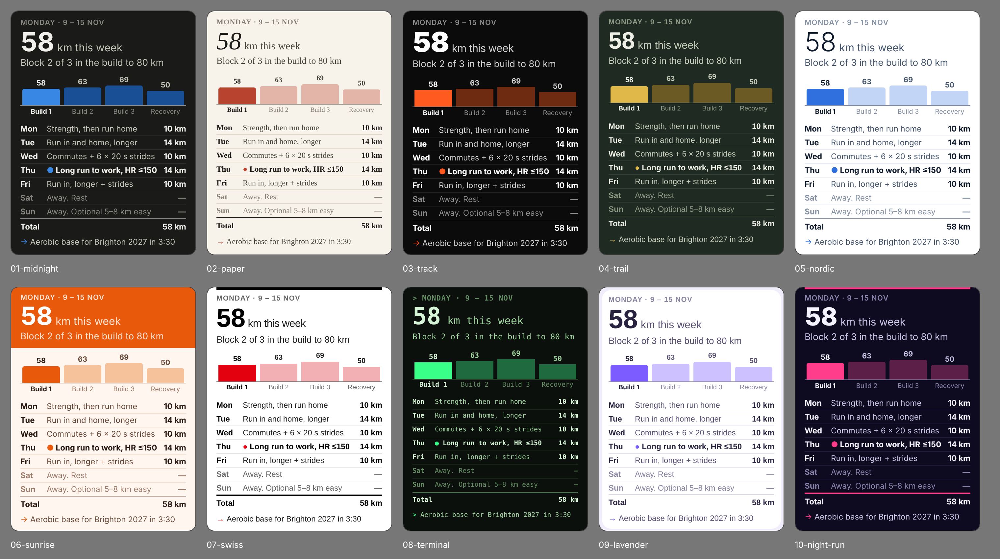

# Monday email: design experiments

The Monday template (`../06-monday.html`) filled with the week of 9 Nov 2026 in
10 design schemes. The content, chart and table are identical; only colours,
fonts and a few layout details change. All are original themes, and each fits
one phone screen (about 280 × 370 CSS px).



| # | Design | Idea |
|---|---|---|
| 01 | Midnight | The current design: dark, calm, blue |
| 02 | Paper | Editorial: warm off-white, serif, brick red |
| 03 | Track | Athletic: black, loud orange, heavy type, square bars |
| 04 | Trail | Outdoors: forest green, ochre, humanist sans |
| 05 | Nordic | Minimal: white, light weights, cool blue |
| 06 | Sunrise | Warm: orange header band, peach chart |
| 07 | Swiss | Grid: black and white, red, thick rules |
| 08 | Terminal | Mono: green on black, prompt-style labels |
| 09 | Lavender | Soft: pastel violet, rounded white card |
| 10 | Night run | Neon: deep indigo, hot pink accent |

Re-render (e.g. with another week's JSON):

```
python3 email_templates/monday_designs/render_designs.py [path/to/week.json]
```

Themes live in the `THEMES` list in `render_designs.py`. Each sets the same
colour roles as `render_email.py` (surface, ink, labels, track, this week,
upcoming weeks, done weeks) plus optional switches: `band` (coloured header),
`card` (rounded card on a tinted page), `rule` (thick top rule), `square`
(square bars), `small` (one size down for wide fonts).

Gmail's dark mode recolours light emails (Paper, Nordic, Sunrise, Swiss,
Lavender), so check those on a phone in dark mode before choosing one.
